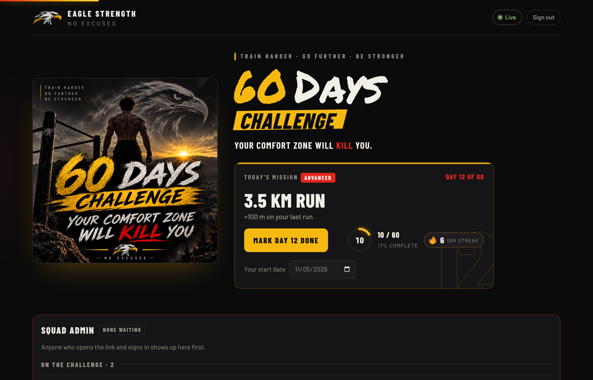
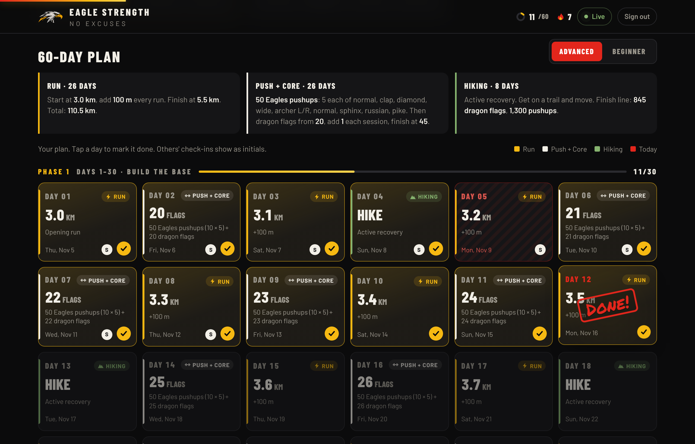
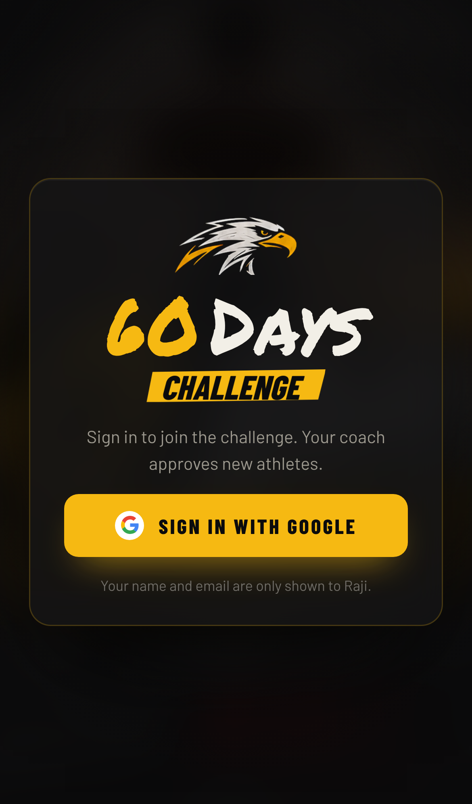

# 60 Days Challenge

A shared 60-day training tracker: alternating run / pushup+core / hiking days,
a live squad board, and separate Beginner and Advanced plans the coach assigns
per athlete.

Everyone ticks their own days. Everyone sees everyone else's progress.



| Ticking a day | Sign-in on a phone |
|---|---|
|  |  |

## Layout

```
public/index.html         the whole app (markup, styles, logic)
public/claude-bridge.js   sign-in + database adapter for self-hosting
public/eagle.png
public/poster.jpg
firebase.json             hosting config
firestore.rules           who may read and write what
.github/workflows/        deploy on push to main
```

## Deploying

See **[DEPLOY.md](DEPLOY.md)**. Short version: a Firebase project, two values
pasted into `public/claude-bridge.js`, `firebase deploy`. Free tier is plenty.

## How joining works

1. You send someone the link.
2. They sign in with Google and a request is filed automatically.
3. They see "Access requested" and nothing else.
4. You see them under **Access requests** and tap Approve.
5. They're on the squad board. You assign Beginner or Advanced.

If someone drops out, **Take off** in the same panel removes them from the
board and revokes their access. **Let back in** reverses it, though they
restart from day 1.
